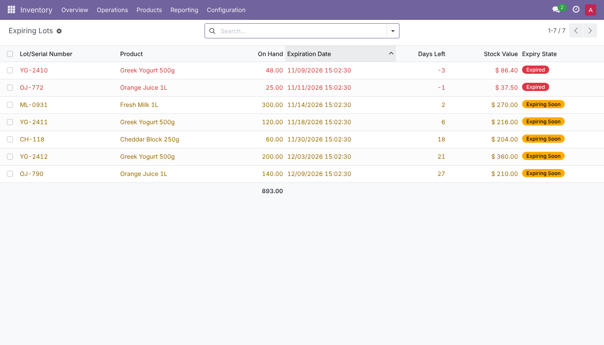

# Odoo Addons

[](https://github.com/bass-sow/odoo-addons/actions/workflows/tests.yml)

Odoo 17 Community modules for everyday needs in distribution companies: stock about to
expire, quotations sold below margin and customers who pay late. Each module is small,
does one thing, has tests and runs them in CI against a real Odoo 17.

| Module | Area | What it does |
|---|---|---|
| [stock_lot_expiry_alert](stock_lot_expiry_alert) | Inventory | Expiry state on lots, "Expiring Lots" report and a daily email with the stock at risk |
| [sale_margin_approval](sale_margin_approval) | Sales | Quotations below a minimum margin need a Sales Manager's approval before confirmation |
| [account_payment_reminder](account_payment_reminder) | Accounting | Reminder emails for overdue customer invoices by levels (7/15/30 days), one email per customer |



## Try them

```bash
docker compose up -d            # Odoo 17 + PostgreSQL, http://localhost:8069
```

Create a database, enable developer mode, *Apps > Update Apps List* and install the
modules. The repository is mounted as an addons path, so code changes only need a
restart (`docker compose restart odoo`) and a module upgrade.

## Tests

```bash
./scripts/run_tests.sh                         # every module, in a throwaway database
./scripts/run_tests.sh sale_margin_approval    # a single one
```

The script installs the modules in a fresh database inside the `odoo:17.0` image, runs
their tests and fails if any test or module load fails. GitHub Actions runs the same
script on every push, plus `ruff` and an XML check.

| Module | Tests |
|---|---|
| stock_lot_expiry_alert | 7 |
| sale_margin_approval | 11 |
| account_payment_reminder | 10 |

## Conventions

- One module per folder, `17.0.x.y.z` versions, LGPL-3.
- Inherit standard views with xpath, no copies of core views.
- Configuration lives on the company (multi-company safe) and is shown in the standard
  settings screens.
- Scheduled actions send one summary email instead of one per record.

## License

LGPL-3. See [LICENSE](LICENSE).
