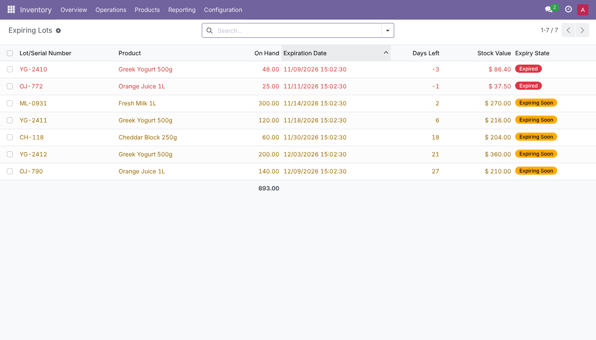
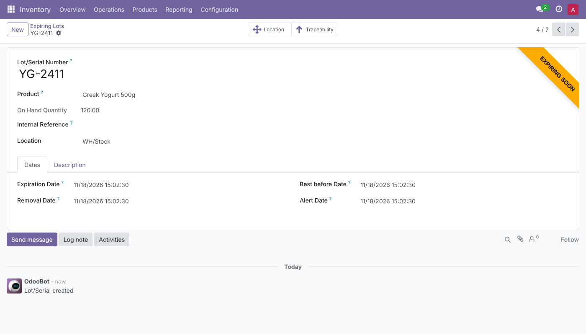
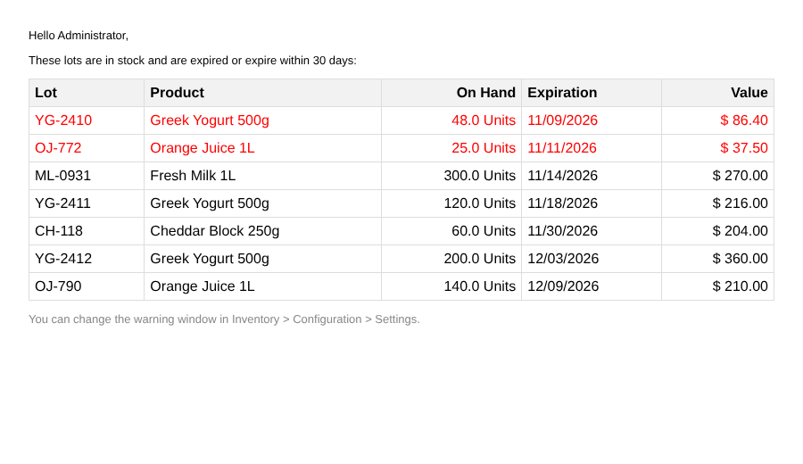

# Stock Lot Expiry Alert (Odoo 17)

Odoo 17 module for warehouses that handle perishable goods. It flags lots that are
close to their expiration date and sends a daily email with the stock at risk, so
the team can move or discount it before it has to be scrapped.

Odoo's `product_expiry` already stores expiration dates and can log an activity per
lot when its alert date is reached. In practice, with a lot of references, that means
dozens of separate activities. This module adds a single company-wide view and one
daily summary instead.



## Features

- **Expiry state on lots**: `OK`, `Expiring Soon` or `Expired`, based on a warning
  window (in days) configured per company. Shown as a badge in the lot list and as a
  ribbon on the lot form.
- **Days left and stock value** for each lot (on hand quantity x product cost).
- **Inventory > Reporting > Expiring Lots**: lots in stock that are expired or expire
  within the window, sorted by date, with totals.
- **Search filters** "Expiring Soon" and "Expired" on the standard lot search view.
- **Daily digest email** (scheduled action) to a user chosen in the settings. Only
  lots with quantity in internal locations are included.

| Lot form | Digest email |
|---|---|
|  |  |

## Configuration

Inventory > Configuration > Settings > Traceability > **Expiry Alerts**

- *Days before expiry*: warning window, 30 by default.
- *Send to*: user who receives the digest. If empty, no email is sent for that company.

Products need lot tracking and "Expiration Date" enabled (from `product_expiry`).

## Technical notes

- `expiry_state` is computed (not stored) because it depends on the current date. A
  `search` method translates it into a domain on `expiration_date`, so it can be used
  in filters and in the action domain.
- The digest looks for lots through `stock.quant` (internal locations, quantity > 0)
  to avoid computing `product_qty` lot by lot.
- Multi-company: the threshold and recipient are company fields, and the cron sends
  one email per company.

## Tests

```bash
./scripts/run_tests.sh stock_lot_expiry_alert   # from the repository root
```

## License

LGPL-3
